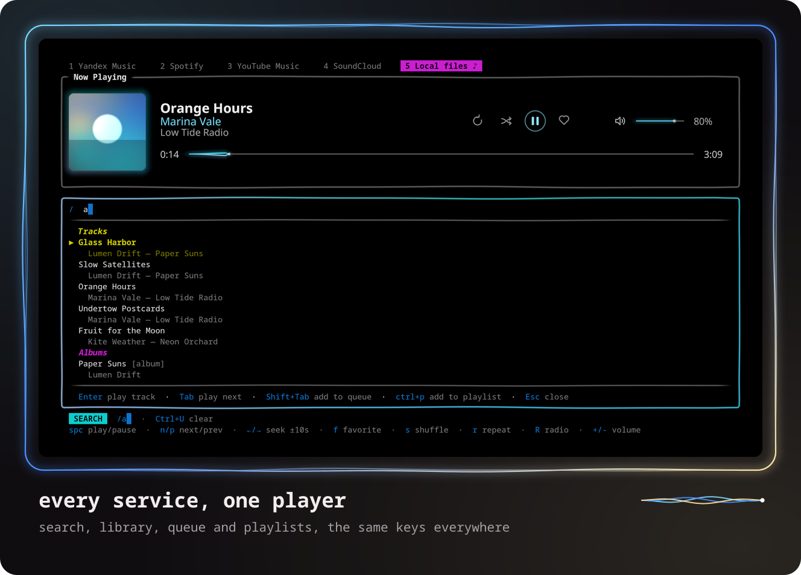
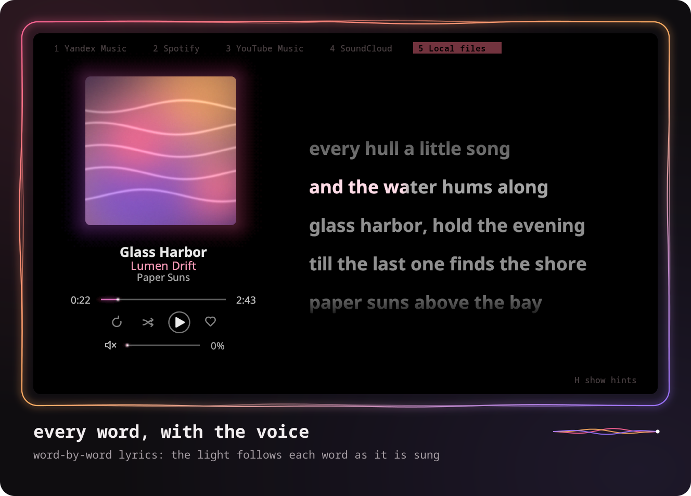

<p align="center">
  
</p>

<h1 align="center">utuimp</h1>

<p align="center">universal terminal user interface media player</p>

<p align="center">
  &nbsp;
  &nbsp;
  &nbsp;
  &nbsp;
  &nbsp;
  &nbsp;
  
</p>

<p align="center">
  <a href="docs/install.md">install</a> ·
  <a href="docs/usage.md">usage</a> ·
  <a href="docs/services.md">services</a> ·
  <a href="docs/configuration.md">config</a> ·
  <a href="docs/troubleshooting.md">problems</a> ·
  <a href="docs/README.md">all docs</a>
</p>

<p align="center">
  
  
</p>
<p align="center">
  
</p>


## install

linux and macos

```bash
curl -fsSL https://raw.githubusercontent.com/tphx37/utuimp/main/scripts/install.sh | sh
```

windows (powershell)

```powershell
irm https://raw.githubusercontent.com/tphx37/utuimp/main/scripts/install.ps1 | iex
```

the script finds what's missing, asks before installing it, and puts utuimp
in `~/.local/bin`. then:

```bash
utuimp
```

pacman, yay and Homebrew packages: [utuimp-repo](https://github.com/tphx37/utuimp-repo).

building from source, requirements, uninstalling - see [docs/install.md](docs/install.md)


script installations on Linux/macOS can be removed with
`rm -f "$HOME/.local/bin/utuimp"`, source installs with `make uninstall`.
for Windows script removal and desktop entries, see
[uninstalling](docs/install.md#uninstalling).


## first start

the first start opens the settings: turn on the services you use, pick the
language, theme and look. `,` opens them again any time (or start on them
with `utuimp setup`).

each service signs in the first time you open its tab. details - see [docs/services.md](docs/services.md)

spotify playback needs a separate librespot installation. librespot 0.8.0
can fail to start tracks with a 403, and until its fix is released, see the
[tested workaround](docs/troubleshooting.md#spotify).

utuimp checks for a new release on each launch and asks before installing it.
use `--no-update` to skip the check. package-managed or non-writable installs
may need to be updated through their package manager instead.

## keys

| key | action |
|---|---|
| `1`, `2`, … | switch service tabs in the order shown |
| `space` | play / pause |
| `n` / `p` | next / previous |
| `←` / `→` | seek by the configured step (10 seconds by default) |
| `+` / `-` | volume |
| `f` | add to favorites; press twice to remove |
| `s` / `r` | shuffle / repeat |
| `R` | start radio from the current song where supported |
| `/` | search; on Radio, find a station or enter a stream link |
| `l` / `L` | open the library / return to its top |
| `Ctrl+R` | rescan folders while the Local files library is open |
| `h` | recently played |
| `F` | feed; on Radio, recent station links |
| `q` | open the queue in cover view |
| `y` | lyrics / show or hide cover-view lyrics |
| `i` | song menu |
| `P` | add the selected or playing song to a playlist |
| `e` | equalizer |
| `v` / `V` | switch boxed and cover views / open the visualizer |
| `,` | settings |
| `H` | hide or show key hints |
| `?` | about |
| `:` | commands, e.g. `:refresh`, `:link URL`, `:save name`, `:q` |
| `esc` | back / close |

see [usage](docs/usage.md) for queue keys, playlist keys and more.

## looks

two views. the **boxed** one shows panels side by side. the **cover** one is
a frameless fullscreen player with the album art and the lyrics. `v` switches
between them.

in kitty and ghostty the interface is drawn in real pixels under the text:
fine lines that sway with the music, the cover itself with a light behind
it, the lyrics large in your system's font, and nothing changes at a stroke,
at sixty frames a second. each part can be left in plain characters, or all
of it, in settings → graphics. see [docs/usage.md](docs/usage.md#the-look)

the pixel interface requires the kitty graphics protocol. on Linux and macOS,
use [kitty](https://sw.kovidgoyal.net/kitty/) or [Ghostty](https://ghostty.org/).
on Windows, try a compatible terminal such as [Noctty](https://noctty.com/)
and set settings → graphics → visualizer as a picture to `on` to enable
protocol detection for the pixel interface too. compatibility may vary. compatible
terminals also work over SSH, with reduced performance since tmux and screen
currently disable graphics. without the protocol, character graphics are used.

`V` turns the whole terminal into a visualizer with six different scenes that reacts to the sound. see [docs/visualizer.md](docs/visualizer.md)

colours follow your terminal by default (`system` theme), or pick `dracula`,
`gruvbox`, `nord`, `classic`, or `mono` (black and white). see [docs/configuration.md](docs/configuration.md)

## something's off

run `utuimp --debug` to save diagnostics and crash reports to `~/.cache/utuimp/debug.log` (on Windows, the utuimp folder in the user cache directory). The log can contain private information, so review it before sharing.

type `:debug-logs` inside utuimp to see what happened, and check
[docs/troubleshooting.md](docs/troubleshooting.md).

## more

- [all docs](docs/README.md)
- [changelog](CHANGELOG.md) · [roadmap](docs/roadmap.md)
- [contributing](CONTRIBUTING.md)

## credits

utuimp started as a fork of [vibez](https://github.com/simonepelosi/vibez) by
simonepelosi. for credits see
[docs/credits.md](docs/credits.md)

apple music requires your own MusicKit developer token. local files on
macos work without one. see [docs/apple-music-tokens.md](docs/apple-music-tokens.md).

not affiliated with yandex, apple, spotify, google or soundcloud.

## license

[GPL-3.0-or-later](LICENSE). parts from vibez stay under MIT, see
[NOTICE](NOTICE).
