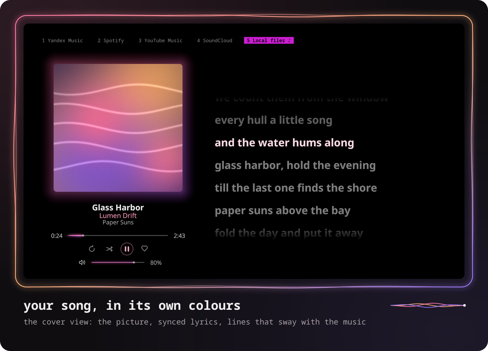
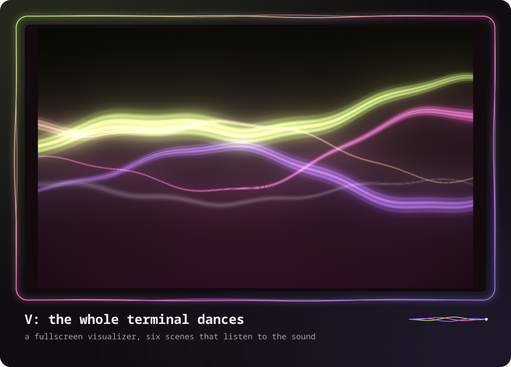
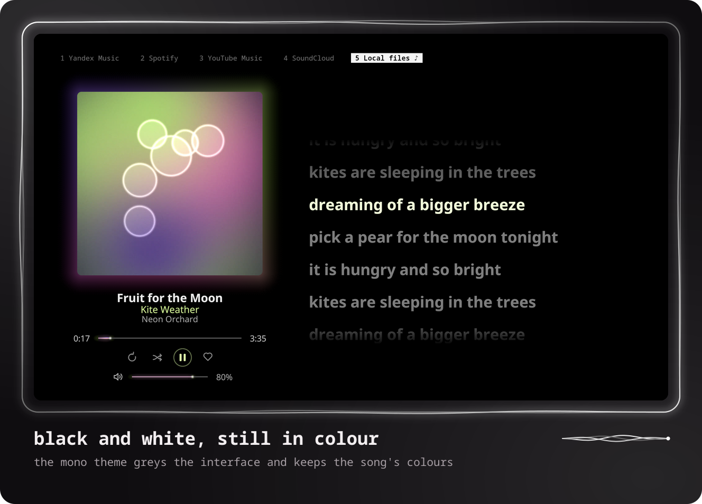

<p align="center">
  
</p>

<h1 align="center">utuimp</h1>

<p align="center">universal terminal user interface media player</p>

<p align="center">
  &nbsp;
  &nbsp;
  &nbsp;
  &nbsp;
  &nbsp;
  
</p>

<p align="center">
  <a href="docs/install.md">install</a> ·
  <a href="docs/usage.md">usage</a> ·
  <a href="docs/services.md">services</a> ·
  <a href="docs/configuration.md">config</a> ·
  <a href="docs/troubleshooting.md">problems</a> ·
  <a href="docs/README.md">all docs</a>
</p>

<p align="center">
  
  
</p>
<p align="center">
  
  
</p>


## install

linux and macos

```bash
curl -fsSL https://raw.githubusercontent.com/tphx37/utuimp/main/scripts/install.sh | sh
```

windows (powershell)

```powershell
irm https://raw.githubusercontent.com/tphx37/utuimp/main/scripts/install.ps1 | iex
```

the script finds what's missing, asks before installing it, and puts utuimp
in `~/.local/bin`. then:

```bash
utuimp
```

building from source, requirements, uninstalling - see [docs/install.md](docs/install.md)

## first start

the first start opens the settings: turn on the services you use, pick the
language, theme and look. `,` opens them again any time (or start on them
with `utuimp setup`).

each service signs in the first time you open its tab. details - see [docs/services.md](docs/services.md)

## keys

| | |
|---|---|
| `space` | play / pause |
| `n` `p` | next / previous |
| `←` `→` | 10 seconds back / forward (the step is in the settings) |
| `+` `-` | volume |
| `f` | favorite |
| `s` `r` | shuffle, repeat |
| `R` | radio from this song |
| `/` | search |
| `l` | library |
| `q` | recently played |
| `y` | lyrics |
| `F` | recommendations |
| `i` | song menu |
| `e` | equalizer |
| `v` | boxed view ↔ cover view |
| `V` | fullscreen visualizer |
| `,` | settings |
| `H` | hide the key hints at the bottom (again: back) |
| `:` | commands (`:vol 50`, `:save name`, `:q`) |
| `esc` | back |

the rest - queue, playlists, lyrics, commands - see [docs/usage.md](docs/usage.md)

## looks

two views. the **boxed** one shows panels side by side. the **cover** one is
a frameless fullscreen player with the album art and the lyrics. `v` switches
between them.

in kitty and ghostty the interface is drawn in real pixels under the text:
fine lines that sway with the music, the cover itself with a light behind
it, the lyrics large in your system's font, and nothing changes at a stroke,
at sixty frames a second. each part can be left in plain characters, or all
of it, in settings → graphics. see [docs/usage.md](docs/usage.md#the-look)

`V` turns the whole terminal into a visualizer with six different scenes that reacts to the sound. see [docs/visualizer.md](docs/visualizer.md)

colours follow your terminal by default (`system` theme), or pick `dracula`,
`gruvbox`, `nord`, `classic`, or `mono` (black and white). see [docs/configuration.md](docs/configuration.md)

## something's off

type `:debug-logs` inside utuimp to see what happened, and check
[docs/troubleshooting.md](docs/troubleshooting.md).

## more

- [all docs](docs/README.md)
- [changelog](CHANGELOG.md) · [roadmap](docs/roadmap.md)
- [contributing](CONTRIBUTING.md)

## credits

utuimp started as a fork of [vibez](https://github.com/simonepelosi/vibez) by
simonepelosi. for credits see
[docs/credits.md](docs/credits.md)

apple music runs on the developer token of vibez, not on one of utuimp's
own. see [docs/apple-music-tokens.md](docs/apple-music-tokens.md).

not affiliated with yandex, apple, spotify, google or soundcloud.

## license

[GPL-3.0-or-later](LICENSE). parts from vibez stay under MIT, see
[NOTICE](NOTICE).
